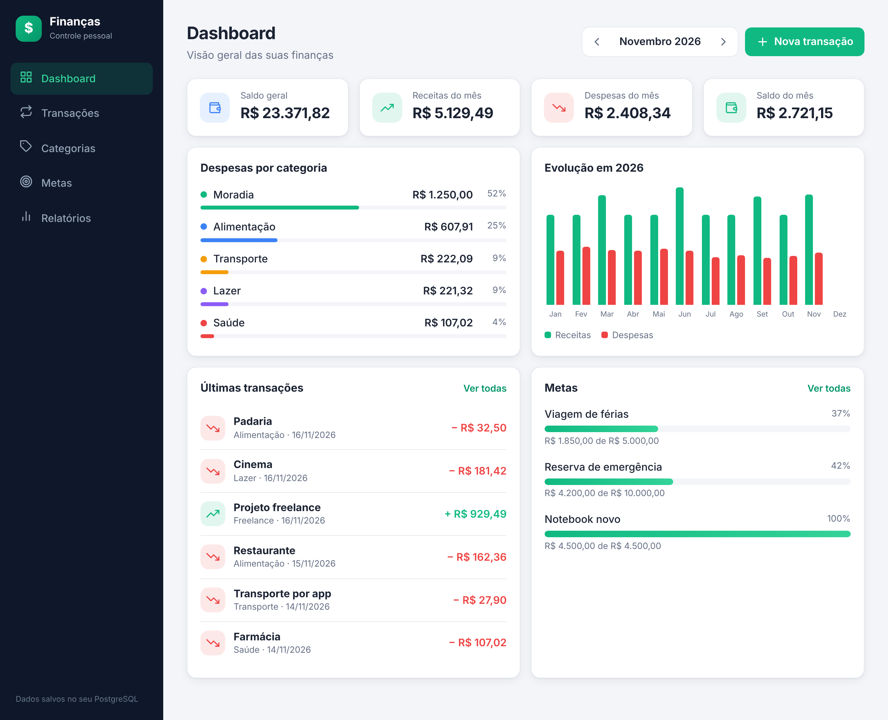
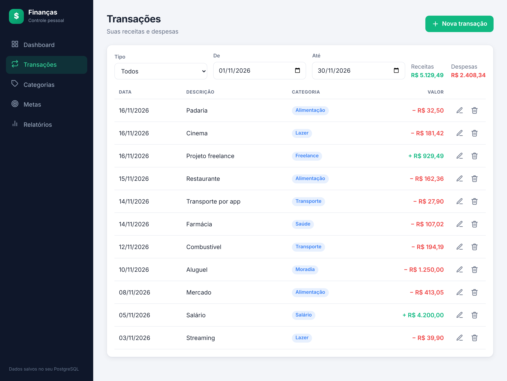
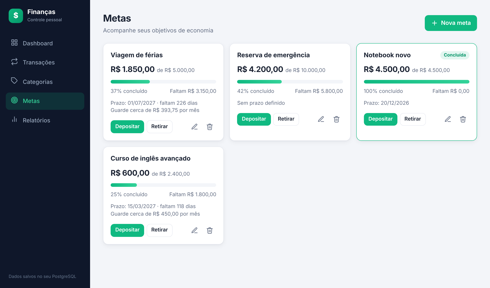
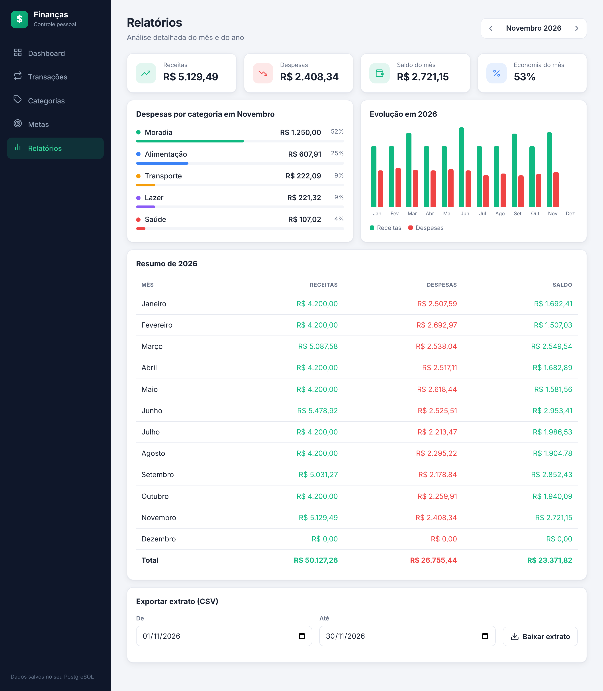
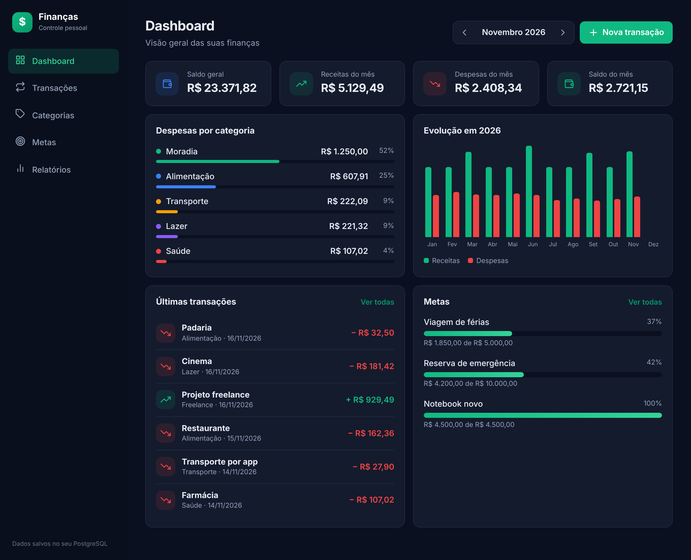
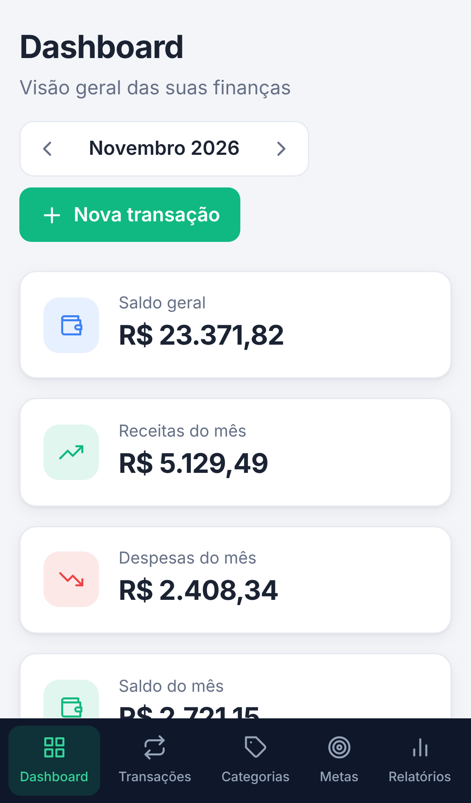
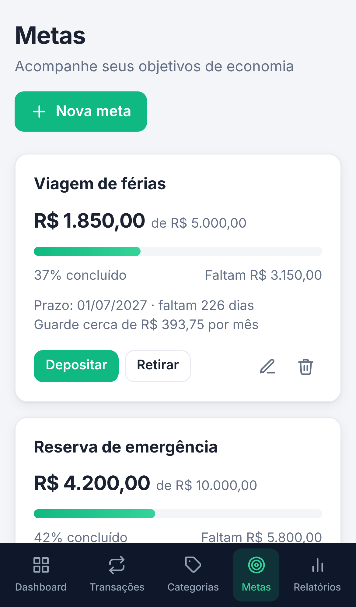

# Controle Financeiro Pessoal

Sistema web para controlar **receitas, despesas, saldo, metas e relatórios**.
Back-end em **Java + Spring Boot + PostgreSQL** e interface em **HTML, CSS e JavaScript puro**,
servida pelo próprio Spring Boot.



> As capturas de tela usam dados fictícios.

## Funcionalidades

- **Dashboard:** saldo geral, receitas e despesas do mês, despesas por categoria, evolução do ano
  em gráfico de barras, últimas transações e progresso das metas. Dá para navegar entre os meses.
- **Transações:** cadastro, edição e exclusão de receitas e despesas, com filtro por tipo e por período.
- **Categorias:** cadastro e edição, com botão para criar categorias padrão de uma vez.
  Não permite excluir uma categoria que já tem transações.
- **Metas:** valor alvo, prazo, depósitos e retiradas. Mostra o percentual, quanto falta e
  quanto guardar por mês para chegar no prazo.
- **Relatórios:** resumo do mês, tabela do ano inteiro e exportação do extrato em **CSV**
  (separador `;`, abre direto no Excel).
- **Interface responsiva** (no celular o menu vira uma barra inferior) e **tema escuro automático**,
  que segue o tema do sistema.

## Capturas de tela

| Transações | Metas |
|---|---|
|  |  |



**Tema escuro e versão para celular**





## Tecnologias

| Camada | Tecnologias |
|---|---|
| Back-end | Java 17+, Spring Boot 3.3, Spring Web, Spring Data JPA (Hibernate), Bean Validation |
| Banco de dados | PostgreSQL |
| Front-end | HTML5, CSS3 (variáveis, Grid, Flexbox, `prefers-color-scheme`), JavaScript ES6 (`fetch`, sem frameworks) |
| Build | Maven |

## Como rodar

**Pré-requisitos:** JDK 17 ou superior, Maven (ou IntelliJ) e PostgreSQL.

**1. Crie o banco de dados**

```sql
CREATE DATABASE financeiro;
```

Se preferir Docker, o projeto traz um `docker-compose.yml`:

```bash
docker compose up -d
```

**2. Configure a senha do banco**

Por padrão a aplicação conecta em `localhost:5432`, usuário `postgres` e senha `postgres`.
Se a sua senha for outra, crie um arquivo `local.properties` ao lado do `pom.xml`:

```
DB_PASSWORD=sua_senha
```

Esse arquivo é lido automaticamente e está no `.gitignore`, então a senha não vai para o repositório.
Também é possível usar as variáveis de ambiente `DB_URL`, `DB_USER` e `DB_PASSWORD`.

**3. Rode a aplicação**

```bash
mvn spring-boot:run
```

**4. Abra no navegador:** <http://localhost:8080>

As tabelas são criadas automaticamente na primeira execução.

## API REST

A interface consome esta API, que também pode ser usada por conta própria (Postman, curl etc.).

### Categorias — `/api/categorias`

| Método | Rota | Descrição |
|---|---|---|
| GET | `/api/categorias` | Lista todas |
| GET | `/api/categorias/{id}` | Busca uma |
| POST | `/api/categorias` | Cria |
| PUT | `/api/categorias/{id}` | Atualiza |
| DELETE | `/api/categorias/{id}` | Exclui (bloqueia se houver transações) |

### Transações — `/api/transacoes`

| Método | Rota | Descrição |
|---|---|---|
| GET | `/api/transacoes?tipo=&inicio=&fim=` | Lista (padrão: mês atual) |
| GET | `/api/transacoes/{id}` | Busca uma |
| POST | `/api/transacoes` | Cria |
| PUT | `/api/transacoes/{id}` | Atualiza |
| DELETE | `/api/transacoes/{id}` | Exclui |

### Metas — `/api/metas`

| Método | Rota | Descrição |
|---|---|---|
| GET | `/api/metas` | Lista com progresso |
| GET | `/api/metas/{id}` | Busca uma |
| POST | `/api/metas` | Cria |
| PUT | `/api/metas/{id}` | Atualiza |
| POST | `/api/metas/{id}/depositos` | Adiciona valor à meta |
| POST | `/api/metas/{id}/retiradas` | Retira valor da meta |
| DELETE | `/api/metas/{id}` | Exclui |

### Relatórios — `/api/relatorios`

| Método | Rota | Descrição |
|---|---|---|
| GET | `/api/relatorios/saldo` | Saldo geral |
| GET | `/api/relatorios/mensal?ano=2026&mes=11` | Resumo do mês + despesas por categoria |
| GET | `/api/relatorios/anual?ano=2026` | Receitas, despesas e saldo de cada mês |
| GET | `/api/relatorios/extrato.csv?inicio=2026-11-01&fim=2026-11-30` | Extrato em CSV |

### Exemplo

```bash
curl -X POST localhost:8080/api/transacoes -H "Content-Type: application/json" \
  -d '{"tipo": "DESPESA", "descricao": "Mercado", "valor": 420.90, "data": "2026-11-08", "categoriaId": 2}'
```

Erros voltam em JSON, por exemplo:

```json
{ "status": 400, "erro": "Dados inválidos: valor: O valor deve ser maior que zero", "timestamp": "..." }
```

## Estrutura do projeto

```
src/main/java/com/financeiro/
├── controller/   # endpoints REST
├── service/      # regras de negócio
├── repository/   # acesso ao banco (Spring Data JPA)
├── model/        # entidades (Categoria, Transacao, Meta)
├── dto/          # objetos de entrada e saída da API (records)
└── exception/    # exceções e tratamento global de erros

src/main/resources/static/   # interface (index.html, css/style.css, js/app.js)
```

## Decisões de projeto

- **Valores em dinheiro** usam `BigDecimal` (precisão 15, escala 2), evitando erros de arredondamento de `double`.
- **Camadas separadas** (controller, service, repository) e **DTOs** para não expor as entidades diretamente.
- **Validação** das entradas com Bean Validation e **tratamento global de erros** (`@RestControllerAdvice`),
  que devolve mensagens em JSON.
- **Regras de negócio** nos services: não excluir categoria em uso, não retirar de uma meta mais do que
  foi depositado, mês do relatório entre 1 e 12.
- **Front-end sem frameworks**, com escape do texto digitado antes de exibir (evita injeção de HTML).

## Ideias para o futuro

- Login e vários usuários, cada um com os próprios dados
- Testes automatizados
- Migrações de banco com Flyway
- Publicação online (deploy)
